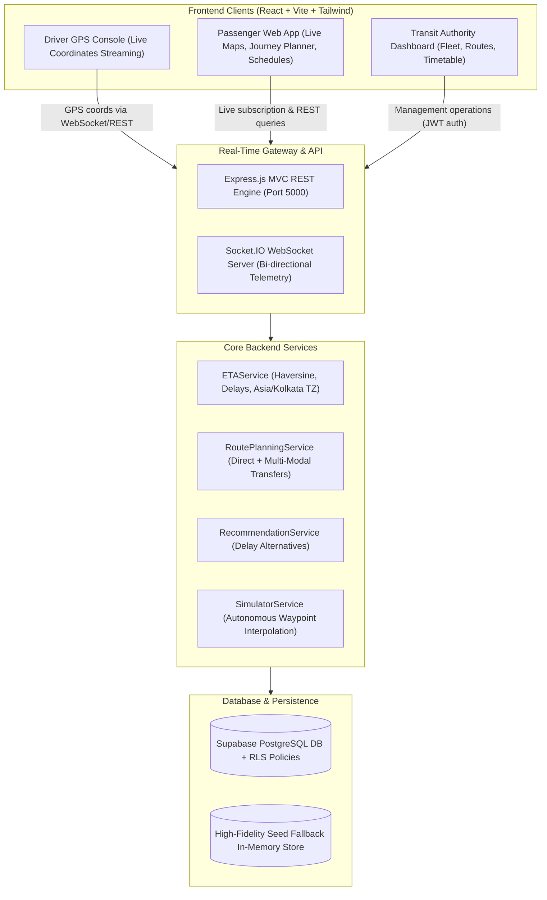
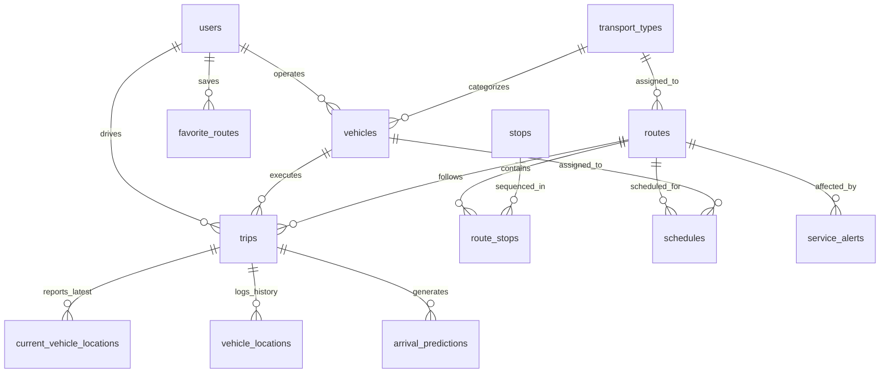

# TransitPulse — Real-Time Public Transport Tracking System for Small Cities


[](https://nodejs.org/)
[](https://expressjs.com/)
[](https://react.dev/)
[](https://vitejs.dev/)
[](https://supabase.com/)
[](https://socket.io/)
[](https://leafletjs.com/)
[](https://tailwindcss.com/)

---

## 1. System Architecture Overview

TransitPulse is a complete, production-grade **Real-Time Public Transport Tracking and Dispatch System** designed specifically for small and intermediate cities (such as Navapura, tier-2/tier-3 state capitals, and regional industrial hubs).

In small cities, transport schedules, vehicle availability, and passenger information are often unstandardized or disrupted by traffic and mixed vehicle fleets. TransitPulse bridges this gap by unifying multiple transport modes (Scheduled City Buses, High-Frequency Feeder Mini-Buses, Point-to-Point Shared Autos, Rapid Electric Buses, and Campus Shuttles) into a single cohesive platform.

### Architecture Diagram



---

## 2. Database Schema & Relationships

The database is built on **Supabase PostgreSQL** with full **Row Level Security (RLS)**, indexes, foreign keys, and cascading rules.

### Entity Relationship Diagram (ERD)



### Table Definitions

| Table Name | Description | Key Columns |
| :--- | :--- | :--- |
| `users` | Role-based user accounts | `id, full_name, email, password_hash, role (passenger, driver, operator, admin)` |
| `transport_types` | Modes of public transit | `id, name, default_capacity, default_speed, default_fare, operating_model, color_code` |
| `vehicles` | Fleet vehicles inventory | `id, vehicle_number, transport_type_id, operator_id, capacity, status` |
| `routes` | Transit routes and corridors | `id, route_name, route_code, start_location, end_location, distance_km, route_geometry` |
| `stops` | Transit stations & stops | `id, stop_name, latitude, longitude, address` |
| `route_stops` | Ordered sequence of stops | `id, route_id, stop_id, stop_order, scheduled_offset_minutes, distance_from_start` |
| `schedules` | Fixed or frequency timetables | `id, route_id, vehicle_id, departure_time, arrival_time, operating_days, frequency_minutes` |
| `trips` | Active or completed journeys | `id, vehicle_id, route_id, driver_id, started_at, completed_at, status` |
| `current_vehicle_locations`| Live snapshot table for fast map reads | `vehicle_id (PK), trip_id, latitude, longitude, speed, heading, eta_next_stop_minutes, delay_status` |
| `vehicle_locations` | Telemetry historical trail | `id, trip_id, vehicle_id, latitude, longitude, speed, heading, recorded_at` |
| `arrival_predictions` | Estimated stop arrival times | `id, trip_id, stop_id, scheduled_arrival, predicted_arrival, delay_minutes` |
| `service_alerts` | Public disruption notices | `id, route_id, vehicle_id, title, description, severity, starts_at, ends_at` |
| `favorite_routes` | Passenger saved routes | `id, user_id, route_id, created_at` |
| `trip_statistics` | Aggregated analytics & delays | `id, trip_id, average_delay_minutes, punctuality_percentage` |

---

## 3. Technology Stack

### Frontend
- **Framework**: React 18 + Vite
- **Styling**: Tailwind CSS with custom Dark Glassmorphism transit theme
- **Mapping**: Leaflet + OpenStreetMap + custom dynamic SVG markers
- **Charts**: Recharts (7 distinct interactive visualizations)
- **Real-Time Client**: Socket.IO Client (automatic reconnect & rooms)
- **Icons**: Lucide React
- **Routing**: React Router v6

### Backend
- **Runtime**: Node.js & Express.js
- **Architecture**: Strict MVC with dedicated Service Layer
- **Real-Time Engine**: Socket.IO WebSocket server with room broadcasting
- **Security**: bcryptjs (work factor 10), JSON Web Tokens (JWT), Helmet, Express Rate Limit, CORS
- **Testing**: Vitest + Supertest automated testing suite

### Database
- **Primary**: Supabase PostgreSQL with SQL migrations & Row Level Security
- **Local Fallback**: High-fidelity in-memory seed database allowing instant plug-and-play development without requiring cloud credentials immediately.

---

## 4. Default Seed Users & Credentials

For evaluation and instant testing, the application comes seeded with pre-configured accounts:

| Role | Email Address | Password | Privileges |
| :--- | :--- | :--- | :--- |
| **Admin** | `admin@transit.city` | `Password@123` | Full system control: fleet, routes, stops, schedules, alerts, user roles |
| **Operator** | `operator@transit.city` | `Password@123` | Route management, fleet scheduling, and active trip monitoring |
| **Driver** | `driver@transit.city` | `Password@123` | Trip lifecycle, live GPS geolocation streaming, incident reporting |
| **Passenger** | `passenger@transit.city` | `Password@123` | Journey planning, live map tracking, favorite route saving |

*(Alternatively, use the **1-Click Demo Buttons** on the Login screen!)*

---

## 5. Development & Installation Guide

### Prerequisites
- Node.js (v18 or higher)
- npm (v9 or higher)

### Step 1: Clone or Navigate to Directory
```bash
cd "c:\Users\Siba\OneDrive\Desktop\bus tracker"
```

### Step 2: Install Backend Dependencies
```bash
cd backend
npm install
```

### Step 3: Configure Backend Environment
Copy `.env.example` to `.env`:
```bash
# Windows PowerShell
copy .env.example .env
```
*(If connecting to Supabase cloud, fill in `SUPABASE_URL` and `SUPABASE_SERVICE_ROLE_KEY`. Otherwise, leave blank to use the built-in local store!)*

### Step 4: Install Frontend Dependencies
```bash
cd ../frontend
npm install
```

### Step 5: Configure Frontend Environment
```bash
copy .env.example .env
```

### Step 6: Start Backend Dev Server
```bash
cd ../backend
npm run dev
# Server listening on http://localhost:5000
```

### Step 7: Start Frontend Dev Server
In a separate terminal window:
```bash
cd frontend
npm run dev
# Frontend running at http://localhost:5173
```

---

## 6. Running Automated Tests

Run the complete backend test suite covering authentication, bcrypt security, ETA calculations, journey recommendations, and analytics:

```bash
cd backend
npm test
```

Sample output:
```text
 ✓ tests/api.test.js (15 tests) 534ms
 Test Files  1 passed (1)
      Tests  15 passed (15)
```

---

## 7. Key Features Explained

### 1. Real-Time Vehicle Tracking & Live Map
- Interactive Leaflet map with dark theme Carto tiles.
- Vehicles render with custom pulsing markers that rotate dynamically with heading.
- Click any vehicle to inspect speed, next stop, ETA, delay status, and full arrival prediction timetable.
- Toggle between live driver GPS updates and the autonomous background demo simulator.

### 2. ETA & Delay Calculation Engine (`ETAService`)
- Calculates accurate geographic distances along route segments using the Haversine formula.
- Incorporates real-time GPS speed and fallback operational averages.
- Formal delay definitions:
  - `Delay = Actual/Predicted Arrival - Scheduled Arrival`
  - `Positive Delay = Late`, `Zero = On Time`, `Negative = Early`
- Formatted in local Indian Standard Time (`Asia/Kolkata`).
- Includes freshness uncertainty scoring (`high`, `medium`, `unreliable` if stale > 120s).

### 3. Multi-Modal Journey Planner (`RoutePlanningService`)
- Searches direct transit routes and 1-transfer connections (e.g. Shared Auto to Central Station, then City Bus to Tech Park).
- Enforces configurable transfer buffers (5–8 minutes) so passengers never miss connections.
- Ranks suggestions by Earliest Arrival, Lowest Fare, Fewest Transfers, or Shortest Duration.

### 4. 7 Graphical Analytics Visualizations (Recharts)
1. **Transport Delay Trends**: Line chart of average delay across hours of day.
2. **On-Time Performance**: Bar chart comparing punctuality percentages against 90% municipal SLA.
3. **Scheduled vs Actual Travel Duration**: Grouped bar chart comparing timetable vs actual duration.
4. **Daily Transport Frequency**: Stacked bar chart of completed trips across Mon–Sun.
5. **Delay Distribution**: Histogram categorizing early, on-time, 1–5m late, 6–15m late, >15m late.
6. **Fleet Mode Share**: Donut chart displaying trip distribution among transport types.
7. **Peak Travel Hours**: Area gradient chart displaying passenger commute surges.
- One-click **Export Analytics CSV** for transit authority reporting.

### 5. Driver GPS Geolocation Portal
- Driver logs in and selects assigned vehicle & route.
- "Start Active Trip" connects to `navigator.geolocation.watchPosition` to stream live latitude, longitude, speed, and heading over WebSockets.
- Graceful permission denial, accuracy warnings, and 1-click delay/breakdown alerts.

---

## 8. REST API Reference

| Method | Endpoint | Description | Auth Required |
| :--- | :--- | :--- | :--- |
| `POST` | `/api/auth/register` | Register new user account | None |
| `POST` | `/api/auth/login` | Authenticate with bcrypt & receive JWT | None |
| `GET` | `/api/auth/me` | Fetch authenticated user profile | Bearer JWT |
| `GET` | `/api/transport-types` | List all transport modes | None |
| `GET` | `/api/vehicles` | List all fleet vehicles & status | None |
| `GET` | `/api/routes` | List all transit routes | None |
| `GET` | `/api/routes/:id` | Get route details with ordered stops | None |
| `GET` | `/api/stops` | List all transit stops | None |
| `GET` | `/api/stops/nearby` | Proximity search stops (`lat, lng, radius_km`) | None |
| `GET` | `/api/schedules` | Query timetables & frequencies | None |
| `GET` | `/api/tracking/vehicles` | Query live vehicle snapshot telemetry | None |
| `POST` | `/api/tracking/location` | Driver device GPS coordinates ingest | Driver / Operator |
| `POST` | `/api/tracking/trips/start` | Start an active trip | Driver / Operator |
| `POST` | `/api/tracking/trips/end` | Finish an active trip | Driver / Operator |
| `POST` | `/api/tracking/simulator/toggle` | Toggle demo GPS simulation engine | None |
| `GET` | `/api/journeys/search` | Search direct and transfer routes | None |
| `GET` | `/api/journeys/alternatives` | Get parallel route recommendations | None |
| `GET` | `/api/analytics/summary` | Top-level operational metrics | None |
| `GET` | `/api/analytics/delays` | Hourly delay trend data | None |
| `GET` | `/api/analytics/punctuality` | On-time performance statistics | None |
| `GET` | `/api/alerts` | Active service disruptions | None |
| `POST` | `/api/alerts` | Broadcast new service alert | Admin / Operator |
| `GET` | `/api/favorites` | Get passenger bookmarked routes | Bearer JWT |
| `POST` | `/api/favorites` | Add route to favorites | Bearer JWT |

---

## 9. Production Deployment Guide

### Deploying the Backend
1. Deploy to **Render**, **Railway**, **Fly.io**, or **DigitalOcean App Platform**.
2. Configure Environment Variables:
   - `PORT=5000`
   - `NODE_ENV=production`
   - `SUPABASE_URL=https://your-project.supabase.co`
   - `SUPABASE_SERVICE_ROLE_KEY=your_service_role_key`
   - `JWT_SECRET=your_long_cryptographic_secret`
   - `FRONTEND_URL=https://your-frontend-domain.vercel.app`
3. WebSockets: Ensure your hosting provider supports persistent WebSocket connections (Socket.IO).

### Deploying the Frontend
1. Deploy to **Vercel**, **Netlify**, or **Cloudflare Pages**.
2. Build Settings:
   - Build Command: `npm run build`
   - Output Directory: `dist`
3. Environment Variables:
   - `VITE_API_URL=https://your-backend-domain.onrender.com/api`
   - `VITE_SOCKET_URL=https://your-backend-domain.onrender.com`

### Applying Supabase Migrations in Cloud
1. In the Supabase Dashboard, navigate to the **SQL Editor**.
2. Open and execute `backend/supabase/migrations/001_initial_schema.sql`.
3. Open and execute `backend/supabase/seed.sql` to populate sample data.
4. Under **Database > Replication**, enable Realtime on `current_vehicle_locations` if direct Supabase Realtime subscriptions are desired.

---

## 10. License

TransitPulse is open-source under the [MIT License](LICENSE).
Built with dedication for small and intermediate city public transit accessibility.
